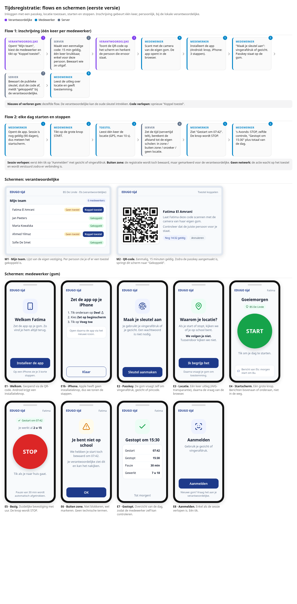

# Tijdsregistratie

Open-source, self-hosted time registration for schools and school groups with multiple sites.
Employees start and stop their working day with one tap in an installable web app (PWA), with a
location check at the moment of clocking. Managers enroll employees in person and follow up their
own sites; admins configure the organisation. One deployment per organisation, shipped as a
container image plus a compose file (app and PostgreSQL). The interface is Flemish (nl-BE) first.



The mockups use a placeholder organisation name and logo; branding is configurable per deployment.

## Features

- One-tap START / STOP for employees, confirmed with the registered time; fixed breaks are deducted
  automatically.
- Location check against the site zone at the moment of clocking. By default an out-of-zone or
  unknown location is stored and flagged for the manager; a site can be set to refuse starts outside
  the zone.
- Passkey sign-in for everyone (employees, managers, admins); no passwords, no external identity
  provider.
- In-person enrollment by a manager with a QR code; device linking and revocation.
- Roles and site scope: employees, managers (own sites), admins (whole organisation).
- "Mijn team" overview with today's status per employee.
- First-run setup wizard in the browser, protected by a one-time setup code from the server log.
- Operator CLI (`admin`) for key generation, bootstrapping an admin, seeding sites, purging
  coordinates and key rotation.

## Privacy and security model

- **Application-level encryption.** Names, e-mail addresses, site addresses and coordinates are
  stored as XChaCha20-Poly1305 ciphertext. The key lives in a file outside the database, and each
  value is bound to its table, column and row. Only ids, timestamps, enums and site configuration
  are plaintext. Exact lookups by name use a separate keyed blind index.
- **Passkeys** (WebAuthn). The server never sees a secret that could be replayed elsewhere. Sessions
  use a `__Host-` prefixed, `Secure`, `HttpOnly` cookie.
- **Append-only events.** `time_event` and `audit_log` reject `UPDATE`, `DELETE` and `TRUNCATE`
  through database triggers (the coordinate purge is the single exception). Corrections (planned) will be new
  rows that reference the original. Every manager and admin mutation writes an audit row.
- **Authoritative server time.** The device clock is informational only; role and site scope are
  checked on the server for every call.
- **Coordinates are temporary.** They are removed automatically after the retention period (default
  31 days); the site and zone status stay.

What the encryption does **not** protect against:

- An attacker who obtains the database **and** the key files (or root on the running host: the app
  holds the keys in memory). Store keys and database backups separately.
- Loss of the data key: all encrypted personal data is then unrecoverable. Back it up offline.
- Metadata in plaintext: who clocked when, at which site, with which zone status.
- A malicious database owner or superuser, who can disable the append-only triggers. See
  "Database hardening" in [docs/operations.md](docs/operations.md) for a least-privilege role setup.

## Quick start (Docker Compose)

Requirements: Docker with the compose plugin, and a domain with a TLS-terminating reverse proxy in
front of the app (passkeys only work on `https://`, or on `http://localhost`).

```sh
git clone https://github.com/edugolo/tijdsregistratie.git
cd tijdsregistratie

# 1. Build the image.
docker build -f deploy/Dockerfile -t tijdsregistratie:latest .

# 2. Generate the two key files (private from the start).
mkdir secrets && chmod 700 secrets
(umask 077; docker run --rm tijdsregistratie:latest admin generate-key --version 1 > secrets/data.key)
(umask 077; docker run --rm tijdsregistratie:latest admin generate-key --version 1 > secrets/blind.key)

# 3. Configure.
cp config/example/.env.example .env
$EDITOR .env    # at least APP_ORIGIN, POSTGRES_PASSWORD and the password in DATABASE_URL

# 4. Start.
docker compose -f deploy/compose.yaml --env-file .env up -d --wait

# 5. Find the setup code and open APP_ORIGIN in a browser.
docker compose -f deploy/compose.yaml logs app | grep 'Setup code'
```

Notes:

- **Set `APP_ORIGIN` to the final domain before the first use.** Passkeys are bound to the domain;
  changing it later invalidates every registered passkey.
- The key files must be readable by the container user (uid 10001 by default). If they are `0600`
  files owned by you, set `APP_UID` and `APP_GID` in `.env` to your own ids (on rootless Docker use
  `0` and `0`, which map to your host user).
- **Back up `secrets/` separately from the database.** See [docs/operations.md](docs/operations.md).
- The app listens on `127.0.0.1:8080` of the host; point your reverse proxy there and set
  `TRUST_PROXY_HEADERS=true` only if it is the sole way to reach the app.
- Admin CLI inside the stack:

  ```sh
  docker compose -f deploy/compose.yaml --env-file .env run --rm app admin setup-code
  docker compose -f deploy/compose.yaml --env-file .env run --rm app admin bootstrap-admin --name "Example Admin"
  ```

Everything else (key rotation, purging coordinates, backups, upgrades) is in
[docs/operations.md](docs/operations.md).

## Development

Requirements: a recent stable Rust toolchain (edition 2024), the `wasm32-unknown-unknown` target,
the Dioxus CLI (`cargo install dioxus-cli --version 0.7.10 --locked`) and a PostgreSQL database.

```sh
cargo fmt --all
cargo clippy --workspace --all-targets -- -D warnings
cargo test -p domain -p crypto                    # fast, no database
DATABASE_URL=postgres://... cargo test -p app     # needs a throwaway database
dx serve --package app                            # dev server with hot reload
dx bundle --package app --release --platform web  # release build
```

Configuration comes from environment variables; see `config/example/.env.example`. Contributor and
agent guidelines are in [AGENTS.md](AGENTS.md); the design guide is [DESIGN.md](DESIGN.md).

## Project layout

```
crates/domain/   pure logic (zone check, day totals, break deduction)
crates/crypto/   field encryption, key loading and rotation
crates/store/    database access (repositories)
crates/app/      Dioxus fullstack app: client UI and server functions
crates/admin/    operator CLI
migrations/      sqlx migrations (applied at startup)
config/example/  example configuration
public/          manifest, icons, service worker
deploy/          Dockerfile and compose file
docs/            plan, operations guide, PWA notes, design mockups
tests/e2e/       browser tests
```

## License

[MIT](LICENSE)
